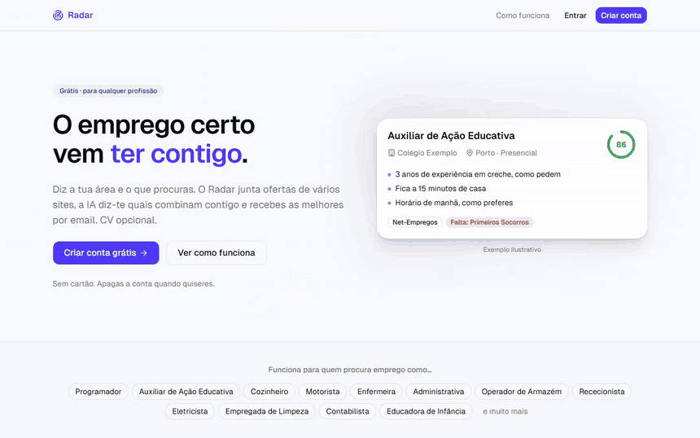
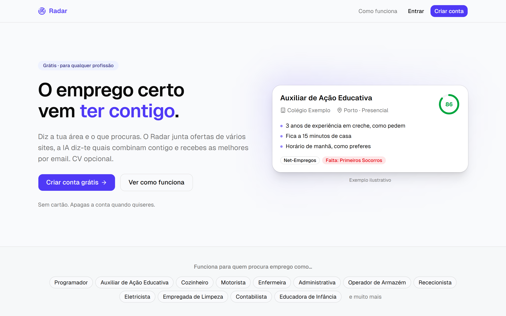
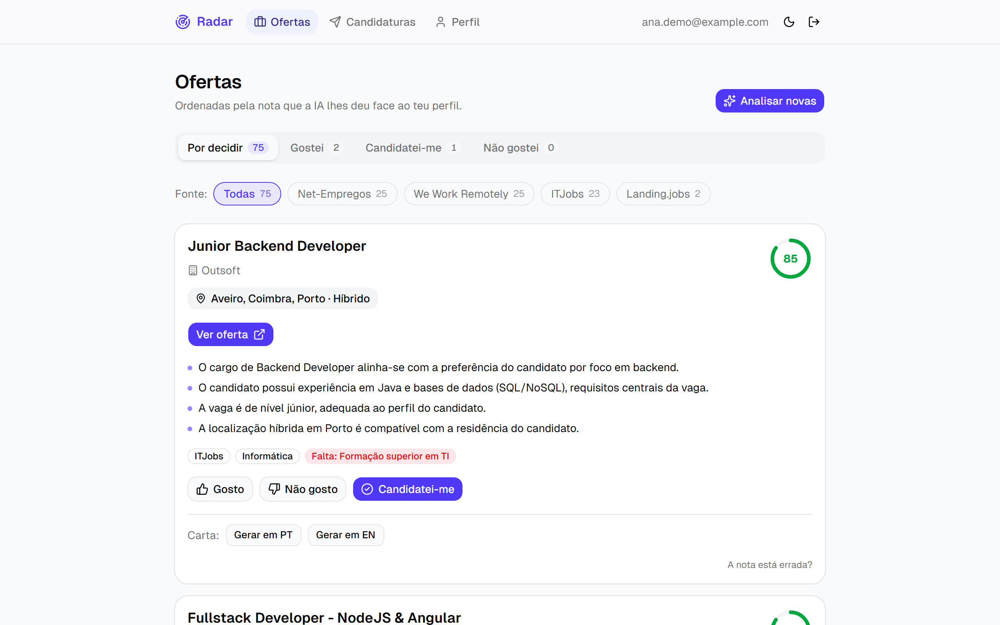
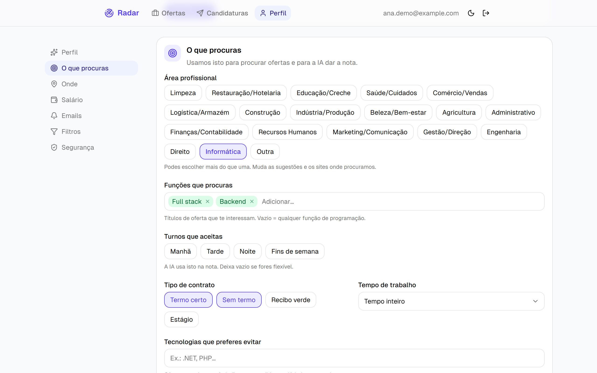
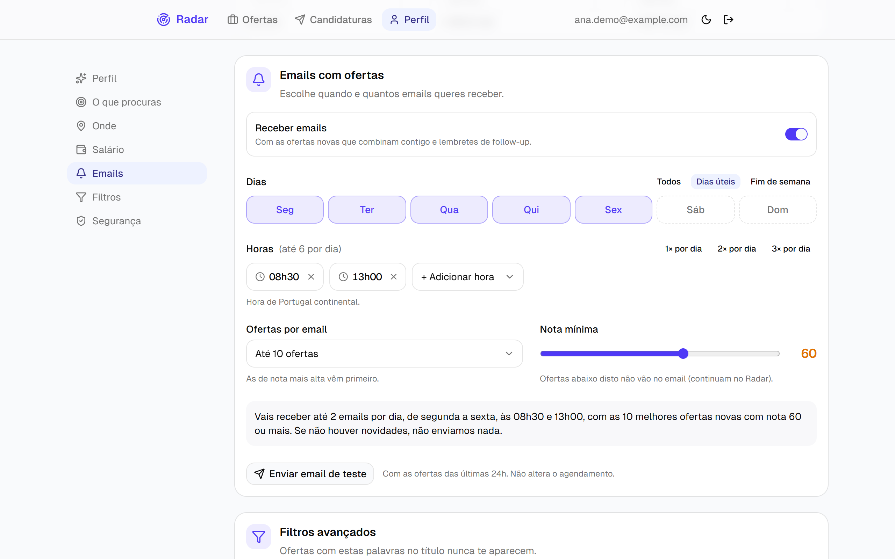
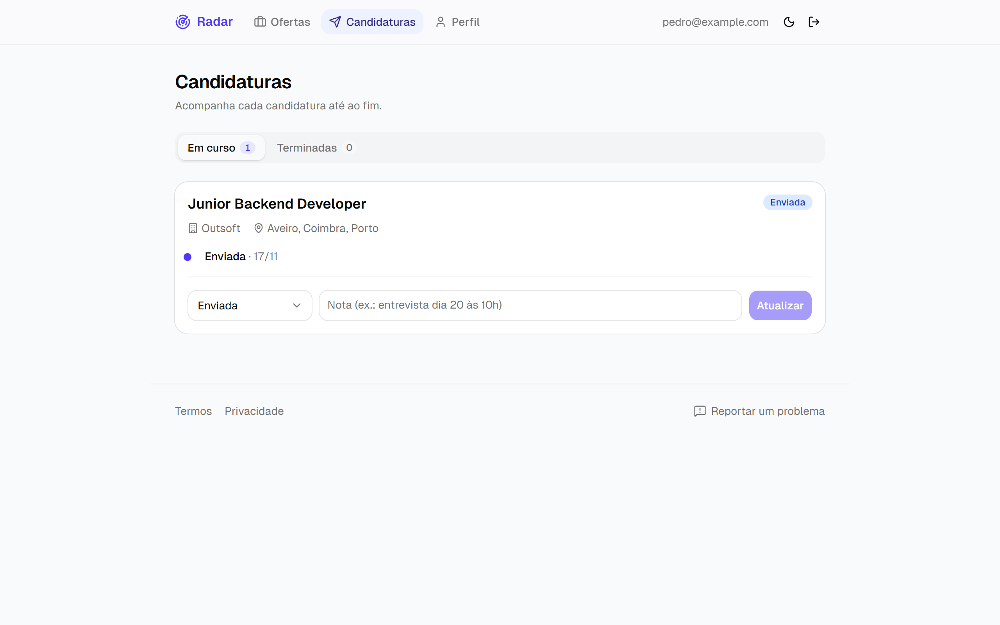
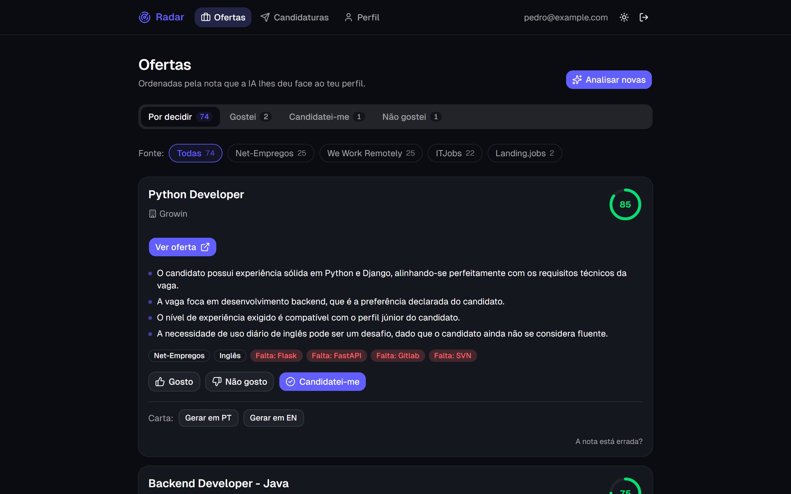
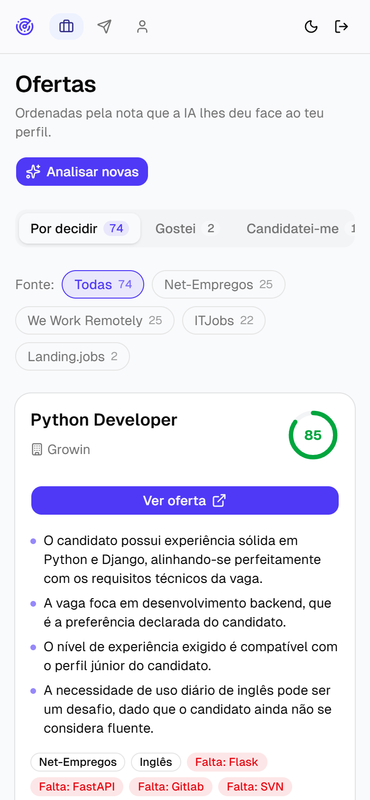
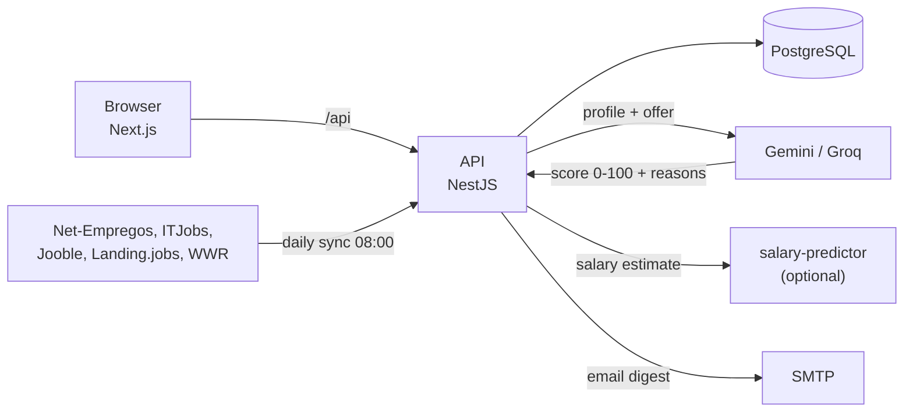

<p align="center">
  
</p>

<h1 align="center">Radar</h1>

<p align="center">
  <b>The right job comes to you.</b><br>
  Offers from many job sites, scored by AI against your profile, delivered to your inbox.
</p>

<p align="center"><a href="README.md">Português</a> · <b>English</b></p>

A job-search assistant for **any profession**, from cleaning staff to chief financial officer.
Users set up their profile once (from a CV or a simple form, no CV needed). Radar gathers job offers from several
job sites, an AI gives each one a score (0–100) against the person's profile and preferences, and the best ones are
emailed on the days and at the times the person chooses.

<p align="center">
  
</p>
<p align="center"><sub>Demo at 2× speed · <a href="docs/media/demo.mp4">full-quality video</a> · fictional demo account</sub></p>


> The app's interface is in Portuguese: it targets the Portuguese job market.

## Features

- **Profile from a CV** (PDF, plus optional LinkedIn) **or from a form with no CV**: experience, education,
  driving licence, field, district/city, shifts and contract type.
- **19 professional fields**: from operational work (cleaning, hospitality, manufacturing, logistics, agriculture…)
  to skilled and management roles (finance, engineering, law, management…), each mapped to the job sites'
  real categories.
- **Filtered offers** by role, location (308 municipalities ↔ districts: the "Aveiro" district matches Ovar,
  "Porto" does not match "Porto de Mós"), experience and words to avoid.
- **AI score** with reasons, missing requirements (licence, certificates, skills), schedule and contract;
  it learns from "like / dislike" and penalises offers above or well below the person's level.
- **Estimated salary** on IT offers that don't state a salary (see below).
- **Filter by source** in the offers list (Net-Empregos, ITJobs, Jooble…).
- **Scheduled emails**: weekdays, up to 6 times a day, number of offers and minimum score.
- **Cover letters** (PT/EN) in plain language and **application tracking** with follow-up reminders.
- **Account**: email confirmation, password recovery/change, sign out other sessions.
- **GDPR**: consent, data export (JSON), account deletion, automatic clean-up, Terms and Privacy pages.
- **Operations**: `/api/health`, email alerts, `/estado` status page for admins, "Report a problem".
- **Light and dark themes** and a mobile-friendly layout.

## Screenshots

| Landing page | Offers ranked by AI score |
| --- | --- |
|  |  |
| **What the person is looking for** | **Scheduled emails** |
|  |  |
| **Application tracking** | **Dark theme** |
|  |  |

<p align="center">
  
  <br><sub>On a phone</sub>
</p>

## Architecture



**Collection:** `daily sync → offers per field and district of each person → normalisation (location, work model, salary) → PostgreSQL`

**Scoring:** `at :15 and :45 → filters (roles, location, experience, words to avoid) → AI gives score + reasons + missing requirements → matches`

**Emails:** `every 30 min → who has an email scheduled for now → new offers above the minimum score → email`

### Design decisions

| Decision | Why |
| --- | --- |
| Deterministic filters before the AI | The AI is the expensive, slow part. Location, experience and excluded words remove most offers without using quota. |
| Municipalities ↔ districts (308) | Job sites write locations in different ways. An explicit map avoids false positives like "Porto" ↔ "Porto de Mós". |
| Gemini with Groq fallback | If a quota runs out or a model fails, scoring carries on with another provider. |
| Scoring rotates between sources | A source with many offers doesn't drown out the others in the AI queue. |
| Postgres locks for scheduled jobs | Several API instances can run at once without duplicate scoring or duplicate emails. |
| Migrations instead of `synchronize` | The schema only changes through versioned migrations, applied automatically on startup. |
| Sessions in an httpOnly cookie | The token is never reachable from JavaScript and only its hash is stored in the DB. |

## Tech stack

| Layer | Technology |
| --- | --- |
| Frontend | Next.js 16 (App Router), React 19, Tailwind CSS 4, shadcn/ui |
| API | NestJS 12, TypeORM, Zod, @nestjs/schedule |
| AI | Google Gemini (`@google/genai`), Groq (fallback) |
| Data | PostgreSQL 16 |
| Emails | Nodemailer + React templates |
| Tooling | Turborepo, pnpm workspaces, Docker Compose, Vitest, Playwright, ESLint, oxlint |

## Project structure

```
apps/
  api/   NestJS + TypeORM (Postgres) — auth, profile, offers, AI (Gemini/Groq), emails, scheduled jobs
  web/   Next.js (App Router) + Tailwind + shadcn/ui — the website
packages/
  eslint-config/       shared ESLint config
  typescript-config/   shared tsconfigs
docs/media/            screenshots and demo
```

## Getting started

### Prerequisites

- Node.js 24+
- pnpm 11
- Docker Desktop
- A [Google Gemini API key](https://aistudio.google.com/apikey) (and optionally Groq)

### Setup

```bash
git clone https://github.com/PedroPinho17/Radar.git
cd Radar
pnpm install
cp apps/api/.env.example apps/api/.env   # fill in the keys (Gemini, Groq, SMTP…)
docker compose up -d                     # starts Postgres (port 5434)
pnpm dev                                 # API on :3001 + website on :3000
```

Open <http://localhost:3000>. To run everything in Docker: `docker compose --profile app up -d --build`.

> More commands (Docker, migrations, tests, backups, monitoring), in Portuguese: **[COMO-CORRER.TXT](COMO-CORRER.TXT)**.

## Database

PostgreSQL 16 (via `docker-compose.yml`), accessed by the API through TypeORM.

- **Migrations** in [`apps/api/src/migrations`](apps/api/src/migrations): the API applies pending ones on startup,
  so an empty database sets itself up.
- **Full schema** (structure only, no data) in [`apps/api/db/schema.sql`](apps/api/db/schema.sql), for reference.
- Tables: `users`, `sessions`, `email_verifications`, `password_resets`, `profiles`, `preferences`, `jobs`,
  `matches`, `applications`, `application_events`, `feedback`, `migrations`.
- Commands: `pnpm --filter api db:show | db:migrate | db:revert | db:generate src/migrations/Name`.
- Backups (`pg_dump`) go in `base-de-dados/`, which is kept out of git because they contain personal data.
  See [COMO-CORRER.TXT](COMO-CORRER.TXT), section 9.

## Job sources

| Source | For | Notes |
|---|---|---|
| ITJobs, Landing.jobs, We Work Remotely | IT | public APIs/RSS (ITJobs needs a key) |
| Net-Empregos | all fields | each person's field categories **in their district**; may block automated requests |
| Jooble | all fields | optional (`JOOBLE_API_KEY`); searches each person's area |

The AI scores offers by rotating between sources, so no single source drowns out the others.

## Estimated salary (external service, optional)

Many offers don't state a salary. For those, Radar can show an estimate
(**"≈ 24 000 €/ano (estimado)"**) requested from a **separate service from another project**: *salary-predictor*,
a small Python API with a model trained on IT salaries in Portugal.

- **Locally** it runs in another terminal on port `8000`, and Radar connects to it via `SALARY_API_URL`:
  - `pnpm dev`: `SALARY_API_URL=http://127.0.0.1:8000` in `apps/api/.env`;
  - Docker: `SALARY_API_URL=http://host.docker.internal:8000` (already in `docker-compose.yml`).
- **It's optional**: without `SALARY_API_URL`, or with the service down, Radar works the same, just without estimates.
  If the service fails, Radar stops calling it for 1 minute.
- **IT only** (that's what the model knows) and **website only**: emails don't request estimates.
- Contract expected by Radar:

  ```http
  POST /estimate
  { "title": "Backend Developer", "years": 1, "skills": ["Python", "JavaScript", "SQL"] }

  200 { "salario_anual_eur": 24000 }
  ```

  Implausible answers (under €5,000 or over €500,000) are ignored. Estimates are cached, identical requests are
  merged and at most 4 requests run at once.

## Quality

- `pnpm test` — unit tests (API and website). Required minimum coverage: 80% lines/statements/functions, 70% branches.
- `pnpm test:e2e` — end-to-end tests in Chrome (sign-up → profile → preferences → delete account), on a separate database.
- `pnpm lint` — ESLint (website) and oxlint (API).

## Security

Passwords hashed with scrypt; sessions in an httpOnly cookie (only the hash is stored in the DB); rate limits and
lockout after failed logins; `Origin` checking; security headers (CSP, HSTS in production…); email tokens in the URL
fragment (never sent to servers) and single-use; Postgres locks for scheduled jobs across multiple instances.

## Author

Made by **Pedro Pinho** · [GitHub](https://github.com/PedroPinho17)
