<p align="center">
  
</p>

<h1 align="center">Radar</h1>

<p align="center">
  <b>O emprego certo vem ter contigo.</b><br>
  Ofertas de vários sites, avaliadas pela IA face ao teu perfil, no teu email.
</p>

<p align="center"><a href="README.md">English</a> · <b>Português</b></p>

Assistente de procura de emprego para **qualquer profissão**, da auxiliar de limpeza ao diretor financeiro.
A pessoa cria o perfil uma vez (com CV ou com um formulário simples, sem CV); o Radar junta ofertas de vários
sites de emprego, a IA dá a cada uma uma nota (0–100) face ao perfil e às preferências, e envia as melhores por
email nos dias e horas que a pessoa escolher.

<p align="center">
  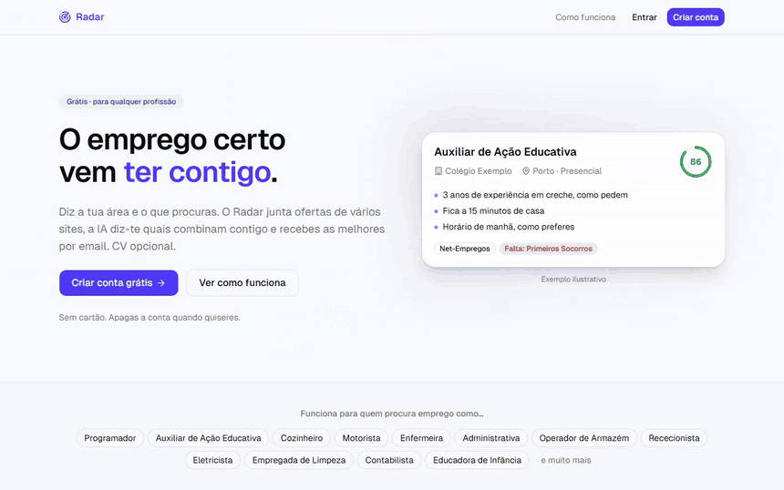
</p>
<p align="center"><sub>Demo a 2× · <a href="docs/media/demo.mp4">vídeo em qualidade total</a> · conta de demonstração fictícia</sub></p>


## Funcionalidades

- **Perfil a partir do CV** (PDF, + LinkedIn opcional) **ou de um formulário sem CV**: experiência, escolaridade,
  carta de condução, área, distrito/cidade, turnos e tipo de contrato.
- **19 áreas profissionais**: do trabalho operacional (limpeza, restauração, indústria, logística, agricultura…)
  aos cargos qualificados e de direção (finanças, engenharia, direito, gestão…), cada uma ligada às categorias
  reais dos sites de emprego.
- **Ofertas filtradas** por funções, localização (308 concelhos ↔ distritos: o distrito "Aveiro" apanha Ovar,
  "Porto" não apanha "Porto de Mós"), experiência e palavras a evitar.
- **Nota da IA** com razões, requisitos em falta (carta, certificados, competências), horário e contrato;
  aprende com os "gosto / não gosto" e penaliza ofertas acima ou muito abaixo do nível da pessoa.
- **Mudar de ideias**: um "gosto" ou "não gosto" pode mudar-se depois, por exemplo para "Candidatei-me".
- **"A nota está errada?"**: cada oferta pode ser reportada num clique; quem gere o Radar recebe um email com a
  mensagem, a oferta, a nota e as razões da IA.
- **Salário estimado** nas ofertas de Informática que não dizem o salário (ver abaixo).
- **Filtro por fonte** na lista de ofertas (Net-Empregos, ITJobs, Jooble…).
- **Emails agendados**: dias da semana, até 6 horas por dia, nº de ofertas e nota mínima.
- **Cartas de apresentação** (PT/EN) em linguagem simples e **acompanhamento de candidaturas** com lembretes de follow-up.
- **Conta**: confirmação de email, recuperar/mudar password, terminar outras sessões.
- **RGPD**: consentimento, exportar dados (JSON), apagar conta, limpeza automática, páginas de Termos e Privacidade.
- **Operação**: `/api/health`, alertas por email, página `/estado` para admins, "Reportar um problema".
- **Tema claro e escuro** e site adaptado a telemóvel.

## Capturas de ecrã

| Página de apresentação | Ofertas ordenadas pela nota da IA |
| --- | --- |
| 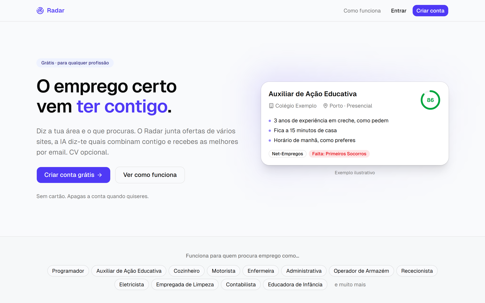 | 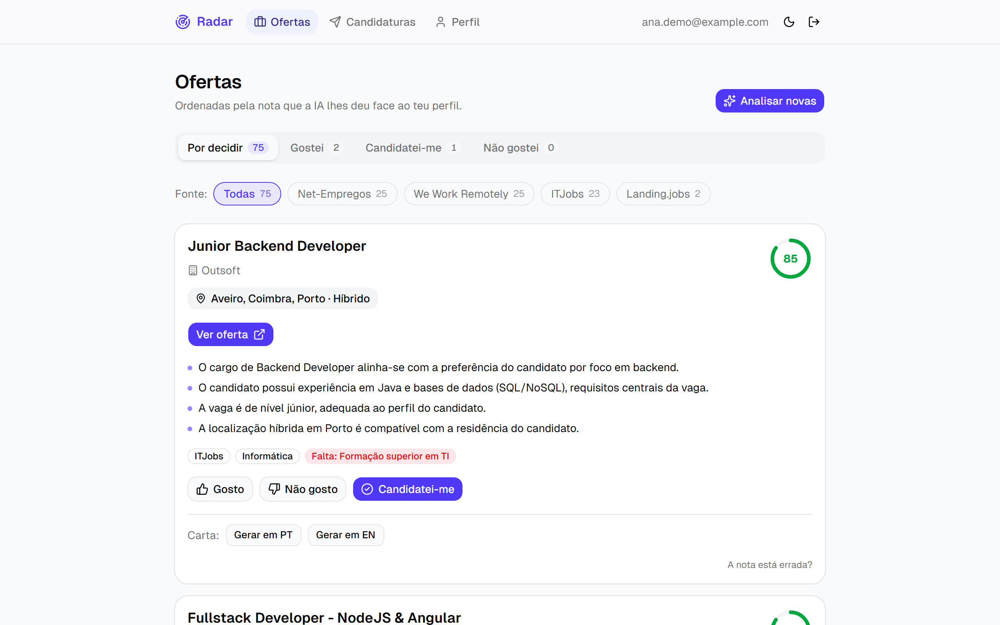 |
| **O que a pessoa procura** | **Emails agendados** |
| 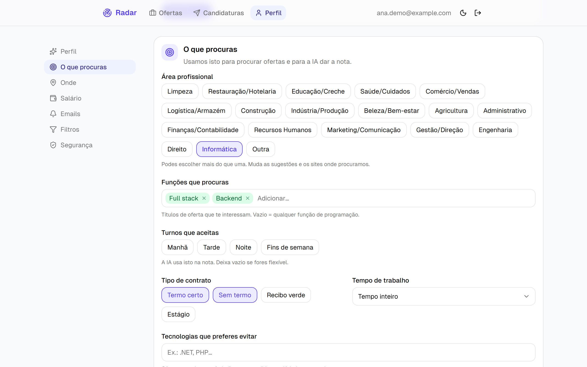 | 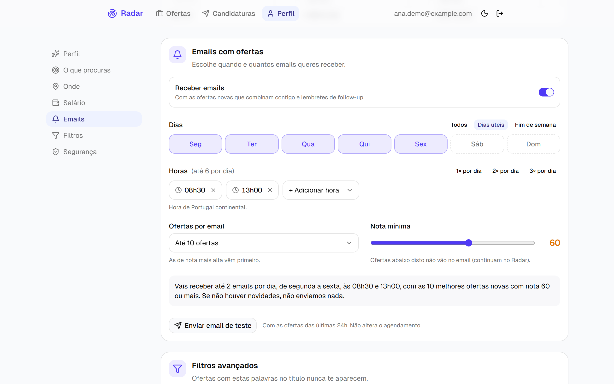 |
| **Acompanhamento de candidaturas** | **Tema escuro** |
| 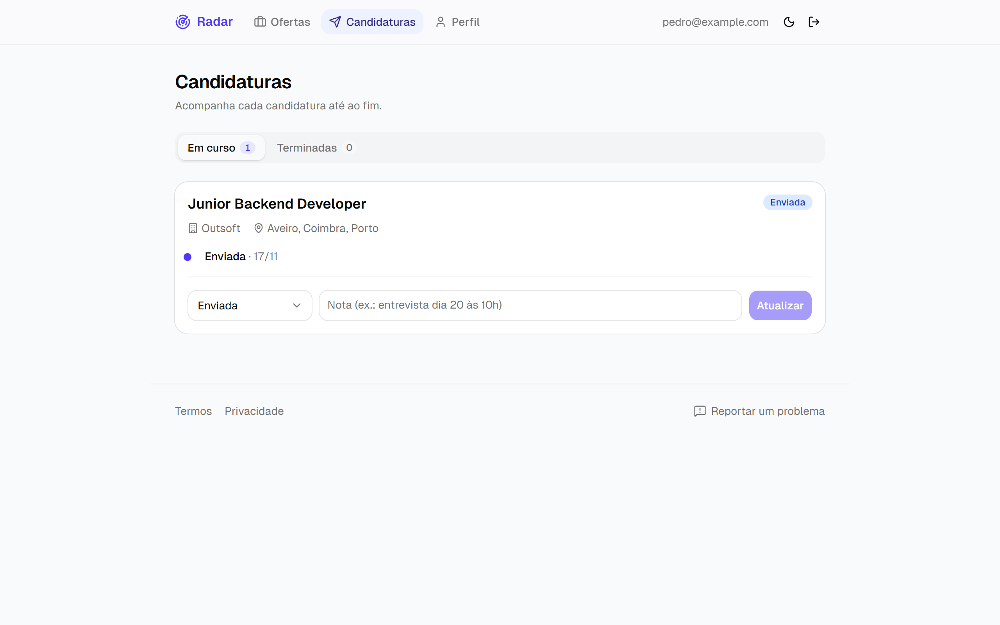 | 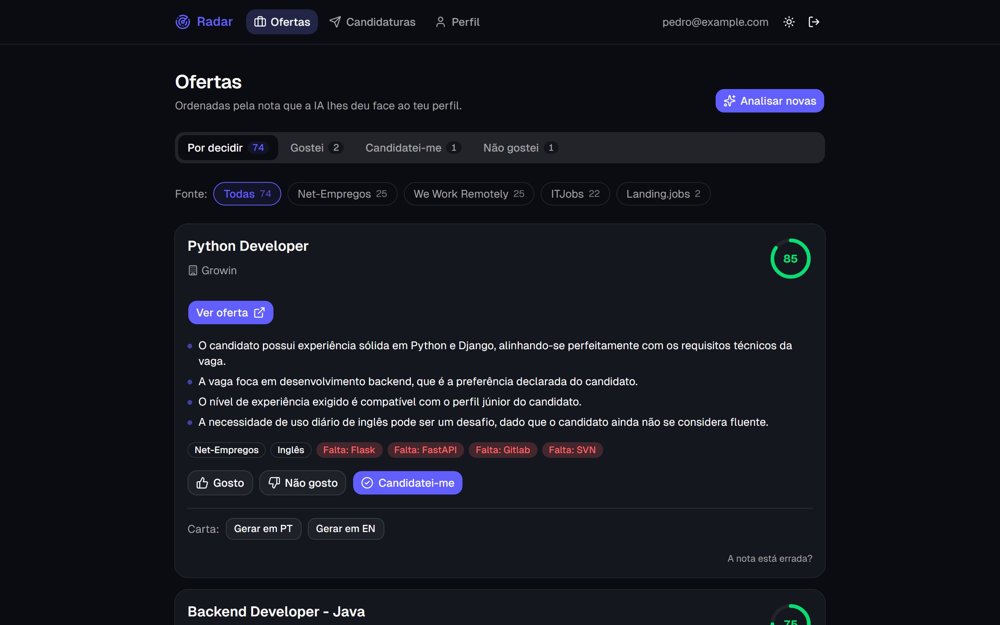 |
| **Mudar de ideias ("Não gostei" → "Candidatei-me")** | **Email de "A nota está errada?"** |
| 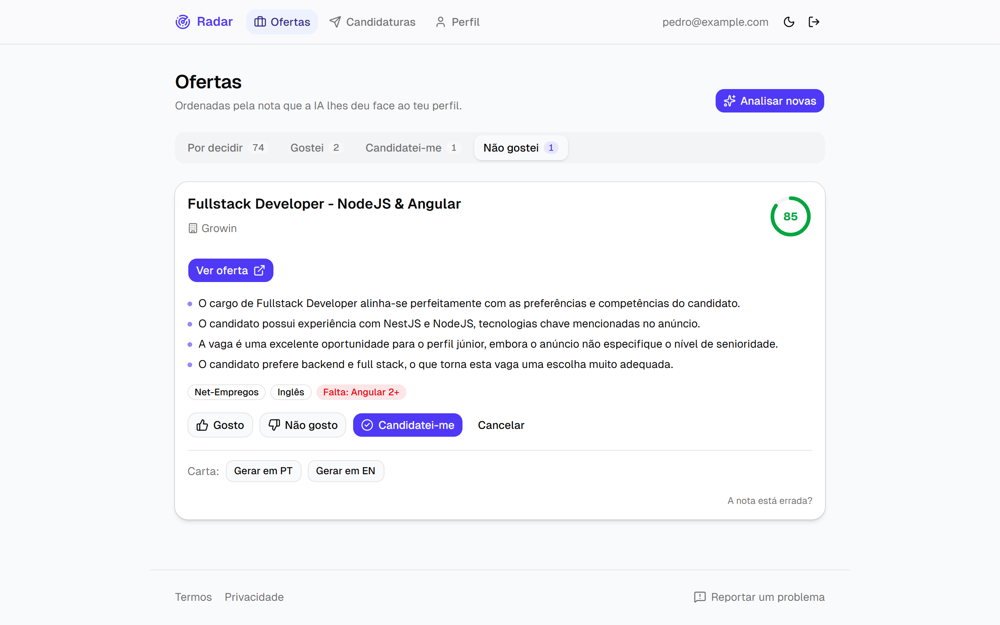 | 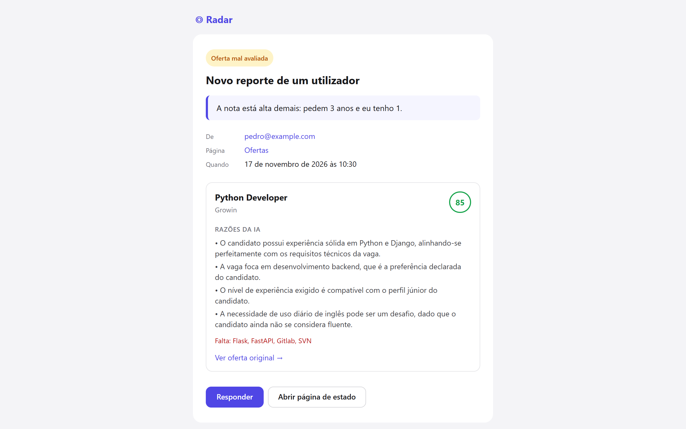 |

<p align="center">
  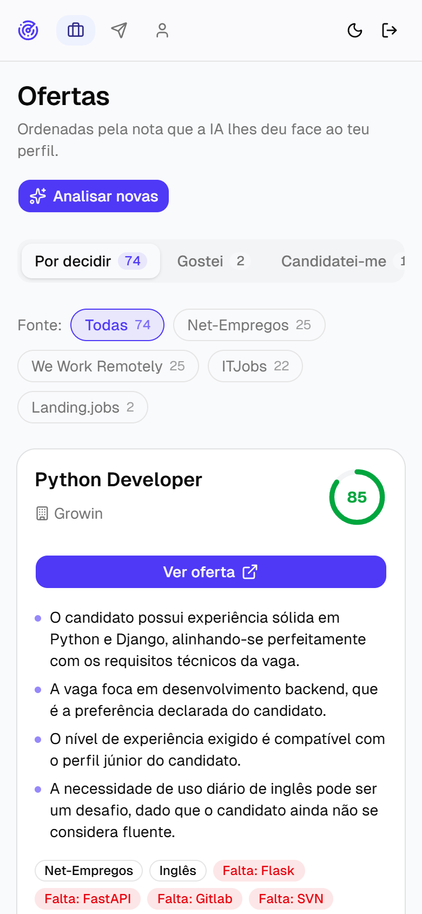
  <br><sub>No telemóvel</sub>
</p>

## Arquitetura

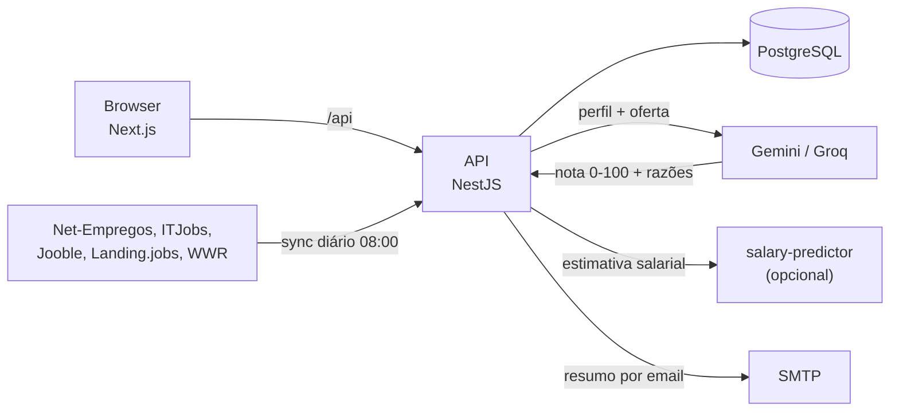

**Recolha:** `sync diário → ofertas por área e distrito de cada pessoa → normalização (local, modelo de trabalho, salário) → PostgreSQL`

**Avaliação:** `aos :15 e :45 → filtros (funções, local, experiência, palavras a evitar) → IA dá nota + razões + requisitos em falta → matches`

**Emails:** `de 30 em 30 min → quem tem email agendado para esta hora → ofertas novas acima da nota mínima → email`

### Decisões de design

| Decisão | Porquê |
| --- | --- |
| Filtros determinísticos antes da IA | A IA é a parte cara e lenta. Localização, experiência e palavras a evitar eliminam a maioria das ofertas sem gastar quota. |
| Concelhos ↔ distritos (308) | Os sites escrevem a localização de formas diferentes. Um mapa explícito evita falsos positivos como "Porto" ↔ "Porto de Mós". |
| Gemini com fallback para Groq | Se uma quota acaba ou um modelo falha, a avaliação continua noutro fornecedor. |
| Avaliação alternada entre fontes | Uma fonte com muitas ofertas não "abafa" as outras na fila da IA. |
| Locks no Postgres para tarefas agendadas | Várias instâncias da API podem correr ao mesmo tempo sem duplicar avaliações nem emails. |
| Migrações em vez de `synchronize` | O esquema só muda por migrações versionadas, aplicadas automaticamente ao arrancar. |
| Sessões em cookie httpOnly | O token nunca fica acessível a JavaScript e na BD só fica o hash. |

## Tecnologias

| Camada | Tecnologia |
| --- | --- |
| Frontend | Next.js 16 (App Router), React 19, Tailwind CSS 4, shadcn/ui |
| API | NestJS 12, TypeORM, Zod, @nestjs/schedule |
| IA | Google Gemini (`@google/genai`), Groq (fallback) |
| Dados | PostgreSQL 16 |
| Emails | Nodemailer + templates React |
| Ferramentas | Turborepo, pnpm workspaces, Docker Compose, Vitest, Playwright, ESLint, oxlint |

## Estrutura

```
apps/
  api/   NestJS + TypeORM (Postgres) — auth, perfil, ofertas, IA (Gemini/Groq), emails, tarefas agendadas
  web/   Next.js (App Router) + Tailwind + shadcn/ui — o site
packages/
  eslint-config/       configuração partilhada do ESLint
  typescript-config/   tsconfig partilhados
docs/media/            capturas de ecrã e demo
```

## Começar

### Requisitos

- Node.js 24+
- pnpm 11
- Docker Desktop
- Uma [chave da API do Google Gemini](https://aistudio.google.com/apikey) (e opcionalmente Groq)

### Instalação

```bash
git clone https://github.com/PedroPinho17/Radar.git
cd Radar
pnpm install
cp apps/api/.env.example apps/api/.env   # preencher as chaves (Gemini, Groq, SMTP…)
docker compose up -d                     # liga o Postgres (porta 5434)
pnpm dev                                 # API em :3001 + site em :3000
```

Abrir <http://localhost:3000>. Para correr tudo em Docker: `docker compose --profile app up -d --build`.

> Mais comandos (Docker, migrações, testes, backups, monitorização): **[COMO-CORRER.TXT](COMO-CORRER.TXT)**.

## Base de dados

PostgreSQL 16 (via `docker-compose.yml`), acedido pela API com TypeORM.

- **Migrações** em [`apps/api/src/migrations`](apps/api/src/migrations): a API aplica as pendentes ao arrancar,
  por isso uma base de dados vazia fica pronta sozinha.
- **Esquema completo** (só estrutura, sem dados) em [`apps/api/db/schema.sql`](apps/api/db/schema.sql), para consulta.
- Tabelas: `users`, `sessions`, `email_verifications`, `password_resets`, `profiles`, `preferences`, `jobs`,
  `matches`, `applications`, `application_events`, `feedback`, `migrations`.
- Comandos: `pnpm --filter api db:show | db:migrate | db:revert | db:generate src/migrations/Nome`.
- Backups (`pg_dump`) ficam em `base-de-dados/`, que está fora do git por conterem dados pessoais.
  Ver [COMO-CORRER.TXT](COMO-CORRER.TXT), secção 9.

## Fontes de ofertas

| Fonte | Para quem | Notas |
|---|---|---|
| ITJobs, Landing.jobs, We Work Remotely | Informática | APIs/RSS públicos (ITJobs pede chave) |
| Net-Empregos | todas as áreas | categorias das áreas de cada pessoa **no distrito dela**; pode bloquear pedidos automáticos |
| Jooble | todas as áreas | opcional (`JOOBLE_API_KEY`); pesquisa na zona de cada pessoa |

A IA avalia as ofertas alternando entre fontes, para nenhuma fonte "abafar" as outras.

## Salário estimado (serviço externo, opcional)

Muitas ofertas não dizem o salário. Para essas, o Radar pode mostrar uma estimativa
(**"≈ 24 000 €/ano (estimado)"**) pedida a um **serviço à parte, de outro projeto**: o *salary-predictor*,
uma pequena API em Python com um modelo treinado com salários de Informática na Europa e nos EUA
(Stack Overflow Developer Survey 2025).

- **Localmente** corre noutro terminal, na porta `8000`, e o Radar liga-se a ele por `SALARY_API_URL`:
  - `pnpm dev`: `SALARY_API_URL=http://127.0.0.1:8000` em `apps/api/.env`;
  - Docker: `SALARY_API_URL=http://host.docker.internal:8000` (já no `docker-compose.yml`).
- **É opcional**: sem `SALARY_API_URL`, ou com o serviço desligado, o Radar funciona igual, só não mostra estimativas.
  Se o serviço falhar, o Radar não insiste durante 1 minuto.
- **Só para Informática** (é o que o modelo conhece) e **só no site**: os emails não pedem estimativas.
- Contrato esperado pelo Radar:

  ```http
  POST /estimate
  { "title": "Backend Developer", "years": 1, "skills": ["Python", "JavaScript", "SQL"], "location": "Lisboa" }

  200 { "salario_anual_eur": 24000, "base": "Portugal" }
  ```

  `location` é a localização da oferta ("Lisboa", "Remoto (USA)"…) ou `null`: o serviço escolhe o país a partir
  dela (vazio → Portugal; remoto sem país → média europeia) e diz qual usou em `base`. O Radar só lê
  `salario_anual_eur`.

  Respostas fora do plausível (menos de 5 000 € ou mais de 500 000 €) são ignoradas. As estimativas ficam em
  cache, pedidos iguais juntam-se e há no máximo 4 pedidos em simultâneo.

## Qualidade

- `pnpm test` — testes unitários (API e site). Cobertura mínima obrigatória: 80% linhas/instruções/funções, 70% ramos.
- `pnpm test:e2e` — testes de ponta a ponta no Chrome (registo → perfil → preferências → apagar conta), em base de dados à parte.
- `pnpm lint` — ESLint (site) e oxlint (API).

## Segurança

Passwords com scrypt; sessões em cookie httpOnly (só o hash na BD); rate limits e bloqueio após falhas de login;
verificação de `Origin`; cabeçalhos de segurança (CSP, HSTS em produção…); tokens de email no fragmento do URL
(nunca enviados a servidores) e de uso único; locks no Postgres para tarefas agendadas com várias instâncias.

## Autor

Feito por **Pedro Pinho** · [GitHub](https://github.com/PedroPinho17)
